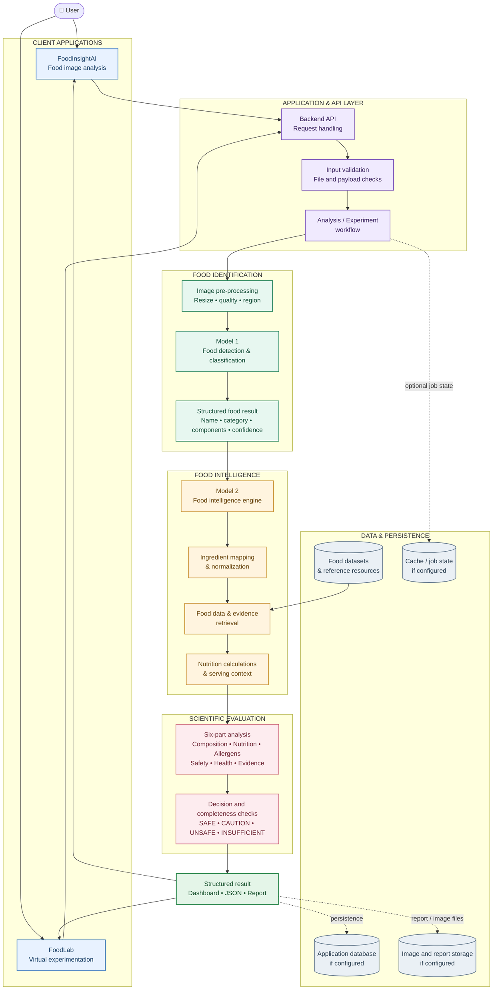
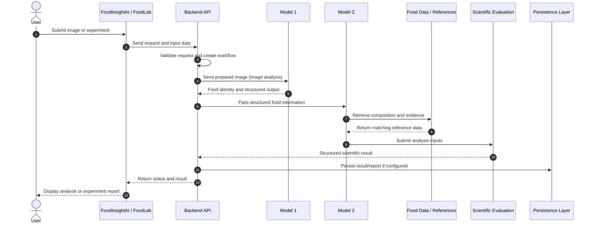
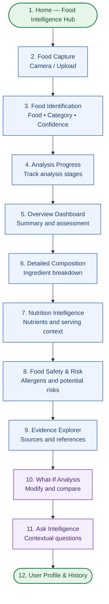
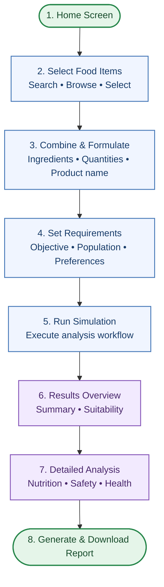
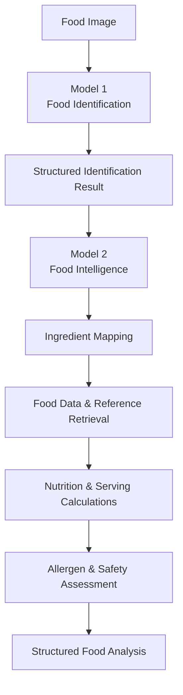
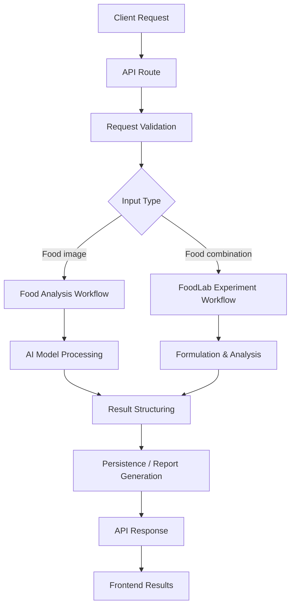
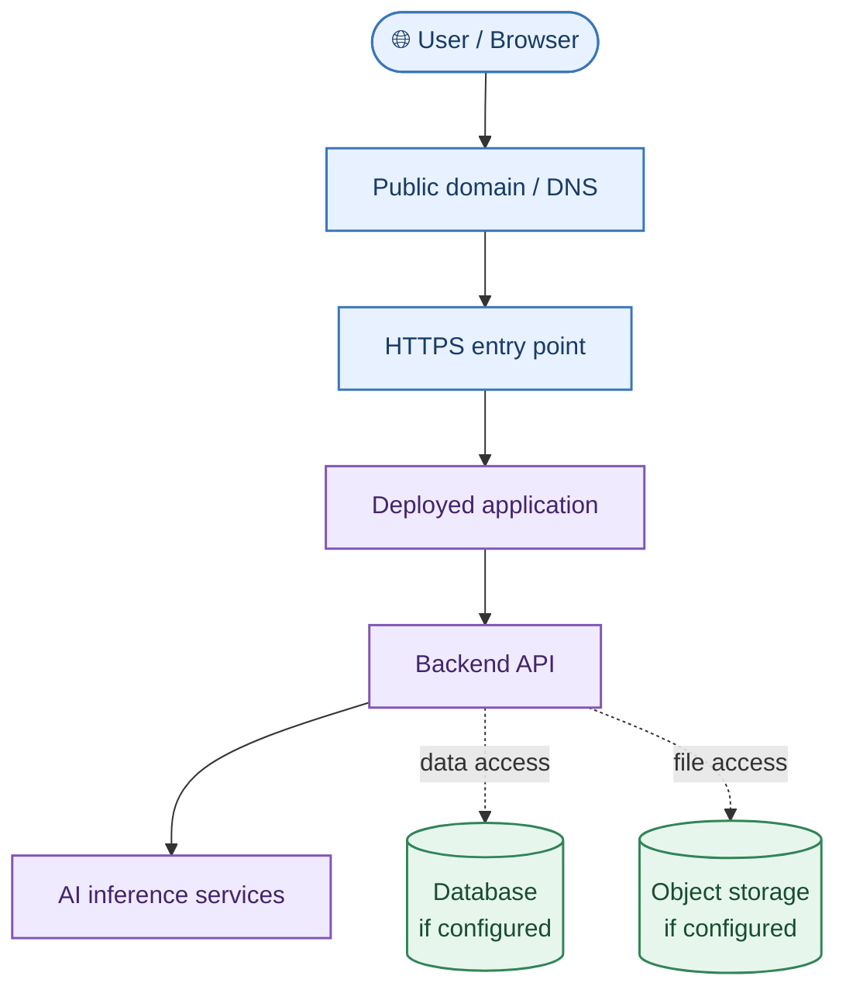
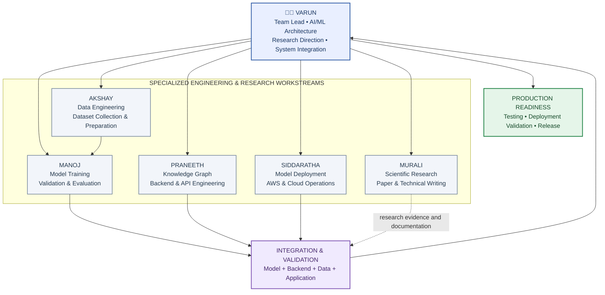

<div align="center">

# 🍎 NutriScientia — Food Insight AI

### AI-Powered Food Intelligence Platform & Virtual Food Experimentation Laboratory

**Understand food. Evaluate nutrition. Explore new formulations.**

[](https://52.87.185.169.nip.io/)


</div>

---

## 📑 Table of Contents

- [1. Project Overview](#-1-project-overview)
- [2. Product Modules](#-2-product-modules)
- [3. Key Capabilities](#-3-key-capabilities)
- [4. Graphical System Architecture](#-4-graphical-system-architecture)
- [5. FoodInsightAI — Application Flow](#-5-foodinsightai--application-flow)
- [6. FoodLab — Application Flow](#-6-foodlab--application-flow)
- [7. Food Analysis — Technical Pipeline](#-7-food-analysis--technical-pipeline)
- [8. Two-Model AI Architecture](#-8-two-model-ai-architecture)
- [9. Six-Part Scientific Analysis](#-9-six-part-scientific-analysis)
- [10. Technology Stack](#-10-technology-stack)
- [11. Datasets & Knowledge Resources](#-11-datasets--knowledge-resources)
- [12. Backend, API & Data Architecture](#-12-backend-api--data-architecture)
- [13. AWS Production Deployment](#-13-aws-production-deployment)
- [14. Repository Documentation Layout](#-14-repository-documentation-layout)
- [15. Development Setup](#-15-development-setup)
- [16. Security & Responsible AI](#-16-security--responsible-ai)
- [17. Project Team](#-17-project-team)
- [18. Team Collaboration & Delivery Workflow](#-18-team-collaboration--delivery-workflow)
- [19. Future Development](#-19-future-development)
- [20. Disclaimer](#-20-disclaimer)

---

## 🌟 1. Project Overview

**NutriScientia – Food Insight AI** is an AI-powered food intelligence platform that combines food image understanding, ingredient analysis, nutrition intelligence, food-safety assessment, scientific evidence retrieval, and virtual food experimentation.

The platform is organized around two connected applications:

1. **FoodInsightAI** — analyzes food images and presents structured insights about food identity, visible ingredients, nutritional composition, allergens, potential safety concerns, and supporting evidence.
2. **FoodLab** — provides a virtual experimentation workflow where users select food items, define quantities and objectives, explore a proposed formulation, and review its nutritional and safety considerations.

The solution is designed around a two-model workflow: a food-identification stage produces structured food information, and a downstream food-intelligence stage uses that information together with food-composition data, reference material, calculations, and analysis rules.

### Project at a glance

| Item | Description |
|---|---|
| Project | NutriScientia – Food Insight AI |
| Domain | Artificial Intelligence, Food Technology, Nutrition Intelligence |
| Product modules | FoodInsightAI and FoodLab |
| Model architecture | Two-stage food identification and food intelligence |
| Analysis approach | AI-assisted interpretation, data retrieval, calculations and rules |
| Deployment endpoint | [52.87.185.169.nip.io](https://52.87.185.169.nip.io/) |
| Team | Six-member AI/ML engineering and research team |

---

## 🧭 2. Product Modules

### 🍽️ FoodInsightAI — Intelligent Food Analysis

FoodInsightAI is the image-led analysis experience. A user captures or uploads a food image. The application identifies the food, interprets visible components, retrieves relevant food-composition information, and presents an organized analysis.

**Primary outputs**
- Predicted food name and category.
- Visible ingredient/component candidates.
- Estimated nutritional composition where sufficient data is available.
- Allergen information and potential cross-contact considerations.
- Potential food-safety and health considerations.
- Supporting references and uncertainty notes.
- Analysis history and report access where implemented.

### 🧪 FoodLab — Virtual Food Experimentation Laboratory

FoodLab is the formulation and experimentation experience. A user selects multiple food items, defines their quantities, provides an experiment objective and constraints, and reviews the resulting analysis.

**Primary outputs**
- Selected ingredient formulation.
- Quantity-aware composition.
- Nutrition analysis.
- Allergen and safety considerations.
- Health and suitability observations.
- Formulation recommendations.
- Downloadable experiment report where enabled.

---

## ✨ 3. Key Capabilities

| Capability | Description |
|---|---|
| Food recognition | Identifies food items and predicts their categories from submitted images. |
| Ingredient understanding | Extracts visible components and maps ingredient names to standardized records where possible. |
| Nutrition intelligence | Retrieves or estimates energy and nutrient composition using available food data and serving information. |
| Allergen assessment | Highlights known allergens and possible cross-contact considerations based on available data. |
| Food-safety analysis | Evaluates potential risks using supplied inputs, available references, and configured rules. |
| Health impact | Presents serving-context and dietary observations without making medical diagnoses. |
| Evidence retrieval | Retrieves relevant food, nutrition, and scientific reference material. |
| What-if analysis | Allows ingredient or quantity changes to be explored and compared. |
| Virtual formulation | Supports food-combination experiments and candidate formulation analysis. |
| Reporting | Presents structured results and supports report generation where implemented. |

---

# 🏗️ 4. Graphical System Architecture

The architecture below describes the logical end-to-end flow of the platform. It is a system-level view; the exact runtime components and service boundaries should be aligned with the deployed repository configuration.

### 4.1 End-to-end platform architecture



### 4.2 Architecture layer responsibilities

| Layer | Responsibility |
|---|---|
| Client applications | Collect food images, food selections, quantities, dietary constraints, and experiment requirements. |
| API layer | Receives requests, validates input, coordinates workflows, and returns results. |
| Image pre-processing | Prepares images for inference and checks basic image quality. |
| Model 1 | Identifies food items and returns structured recognition information. |
| Model 2 | Interprets recognized food information and coordinates deeper food analysis. |
| Data retrieval | Looks up food-composition, ingredient, safety, and research information from available resources. |
| Scientific evaluation | Organizes the analysis into six modules and applies configured rules and checks. |
| Persistence | Stores application records, images, reports, or job state where configured. |
| Results layer | Delivers structured analysis to the application and report workflow. |

### 4.3 Request lifecycle



---

# 📱 5. FoodInsightAI — Application Flow

The following is the twelve-screen user journey represented in the supplied FoodInsightAI application design.


### Screen-by-screen explanation

| Step | Screen | User experience |
|---:|---|---|
| 1 | Home — Food Intelligence Hub | Start food scanning, upload a document, describe food, or open quick actions. |
| 2 | Food Capture | Capture a food photo or select an existing image. |
| 3 | Food Identification | Review the predicted food name, category, confidence, possible matches, and detected components. |
| 4 | Analysis Progress | Follow the analysis stages: image understanding, ingredient resolution, nutrition retrieval, safety checks, evidence retrieval, and insight generation. |
| 5 | Overview Dashboard | Review the high-level summary, nutrition indicators, safety status, and profile context. |
| 6 | Detailed Composition | Explore the estimated ingredient list, proportions, and descriptions. |
| 7 | Nutrition Intelligence | Review calories, macronutrients, fibre, and available micronutrients. |
| 8 | Food Safety & Risk Analysis | Review allergen information, potential food-safety concerns, and risk factors. |
| 9 | Evidence Explorer | Inspect supporting food, nutrition, and scientific reference material. |
| 10 | FoodLab — What-If Analysis | Modify an ingredient or quantity and compare the original and modified food. |
| 11 | Ask Intelligence | Ask follow-up questions about the current food analysis. |
| 12 | User Profile & History | Manage preferences and review previous analyses. |

### FoodInsightAI user-flow diagram



### Main user inputs

- Food image captured through a camera or selected from a device.
- Optional serving size or quantity.
- Optional dietary preferences and constraints.
- Optional allergy information and profile context.

### Main user outputs

- Food identity and confidence.
- Ingredient and composition information.
- Nutrition and serving-context results.
- Allergen and safety observations.
- Evidence and uncertainty notes.
- Analysis history and reports where available.

---

# 🧪 6. FoodLab — Application Flow

FoodLab is the virtual food experimentation workflow. The following eight-screen flow follows the supplied application design.


### Screen-by-screen explanation

| Step | Screen | User experience |
|---:|---|---|
| 1 | Home Screen | Start a new experiment or access the food catalogue, saved experiments, reports, and help. |
| 2 | Select Food Items | Search, browse, filter, and select two or more food items. |
| 3 | Combine & Formulate | Define ingredient quantities and provide a proposed product name. |
| 4 | Set Experiment Requirements | Select a research objective, target population, and optional dietary preferences. |
| 5 | Run Simulation | Start the formulation, nutrition, safety, and health analysis workflow. |
| 6 | Results Overview | Review the overall assessment and key result indicators. |
| 7 | Detailed Analysis | Inspect nutrition, safety, health, and ingredient-level findings. |
| 8 | Generate & Download Report | Generate a report and save the experiment for future reference where supported. |

### FoodLab user-flow diagram



### FoodLab inputs

- Selected food items.
- Ingredient quantities and units.
- Formulation or proposed product name.
- Experiment objective.
- Target population.
- Optional dietary preferences and constraints.

### FoodLab outputs

- Formulation summary.
- Ingredient-level composition.
- Nutrition analysis.
- Allergen and food-safety observations.
- Health and suitability considerations.
- Optimization suggestions where supported.
- Experiment report.

---

# ⚙️ 7. Food Analysis — Technical Pipeline

This six-stage technical pipeline explains how a food image is transformed into a structured analysis result.


### Six-stage processing flow

```mermaid
flowchart LR
    S1["STAGE 1<br/>User Input &<br/>API Ingestion"]
    S2["STAGE 2<br/>Image<br/>Pre-processing"]
    S3["STAGE 3<br/>MODEL 1<br/>Food Identification"]
    S4["STAGE 4<br/>MODEL 2<br/>Food Intelligence"]
    S5["STAGE 5<br/>Six-Part Scientific<br/>Analysis"]
    S6["STAGE 6<br/>Results, Reports<br/>& Storage"]

    S1 --> S2 --> S3 --> S4 --> S5 --> S6

    classDef ingest fill:#E8F1FF,stroke:#3976B8,color:#173C65,stroke-width:2px;
    classDef prep fill:#FFF2DF,stroke:#C1842D,color:#67420D,stroke-width:2px;
    classDef model fill:#F0EAFE,stroke:#8056B5,color:#43256A,stroke-width:2px;
    classDef analysis fill:#E7F6ED,stroke:#318458,color:#174D31,stroke-width:2px;
    classDef output fill:#FCEBED,stroke:#C25A68,color:#6D2933,stroke-width:2px;

    class S1 ingest;
    class S2 prep;
    class S3,S4 model;
    class S5 analysis;
    class S6 output;
```



### Stage 1 — User Input & Ingestion

- Accept a food image from the application.
- Receive optional quantity, serving size, and user constraints.
- Validate the uploaded file and request.
- Create an analysis identifier.
- Forward the request to the processing workflow.

### Stage 2 — Image Pre-processing

- Validate image format and integrity.
- Resize and normalize the image.
- Check image quality, blur, and noise.
- Prepare food regions for model inference.
- Apply the configured detection or segmentation process.

### Stage 3 — Model 1: Food Identification

- Detect one or multiple food items.
- Predict food name and category.
- Identify visible ingredients where possible.
- Generate confidence information.
- Return food regions or bounding boxes if supported.

### Stage 4 — Model 2: Food Intelligence & Data Retrieval

- Receive Model 1's structured output.
- Map and normalize ingredient names.
- Retrieve food-composition information.
- Calculate nutrition using available quantity and serving data.
- Evaluate allergens and potential risks.
- Retrieve supporting evidence where configured.

### Stage 5 — Six-Part Scientific Analysis

The analysis is organized into composition, nutrition, allergen, safety, health-impact, and research-evidence modules.

### Stage 6 — Results, Reports & Storage

- Return structured results.
- Display analysis in the application.
- Generate a report where implemented.
- Persist analysis and experiment records where configured.

---

# 🤖 8. Two-Model AI Architecture

## Model 1 — Food Identification

**Primary objective:** identify the food shown in the submitted image.

| Responsibility | Description |
|---|---|
| Food detection | Locate food items in the image. |
| Food classification | Predict the food name and category. |
| Component recognition | Identify visible food components where possible. |
| Confidence | Return model confidence information. |
| Region output | Return bounding boxes or detected regions if supported. |

### Model 1 output — illustrative JSON

```json
{
  "food_name": "Idli",
  "food_category": "Breakfast",
  "visible_ingredients": ["Idli"],
  "confidence": 0.92,
  "uncertainties": []
}
```

The JSON is an illustrative example. The actual API response schema is defined by the backend implementation.

## Model 2 — Food Intelligence

**Primary objective:** turn identified food information into a deeper, structured analysis.

| Responsibility | Description |
|---|---|
| Ingredient mapping | Map recognized ingredients to standardized food records. |
| Nutrition retrieval | Retrieve relevant composition data. |
| Nutrition calculation | Calculate values using available quantities and serving context. |
| Allergen assessment | Identify known allergens and relevant concerns. |
| Safety evaluation | Assess potential food-safety risks using available evidence and rules. |
| Health impact | Present relevant serving and dietary considerations. |
| Evidence retrieval | Retrieve supporting references where configured. |

### Model communication



**Important distinction:** Model 1 is responsible for visual food identification. Model 2 is responsible for deeper food intelligence and analysis. Neither stage should invent hidden ingredients, exact quantities, or verified safety conclusions that cannot be established from the available information.

---

# 🧬 9. Six-Part Scientific Analysis

| No. | Analysis module | Main purpose |
|---:|---|---|
| 1 | Food & Ingredient Composition | Describe the identified food and its ingredient composition. |
| 2 | Nutritional Analysis | Evaluate energy, protein, carbohydrates, fats, fibre, and available micronutrients. |
| 3 | Allergen Assessment | Identify known allergens and possible cross-contact concerns. |
| 4 | Food Safety & Risk Analysis | Evaluate potential contamination, additives, toxins, and handling-related risks using available information. |
| 5 | Health Impact Analysis | Present serving-context and dietary considerations. |
| 6 | Research Evidence Analysis | Retrieve relevant research, guidelines, and supporting references. |

### Decision classification

| Status | Interpretation |
|---|---|
| 🟢 **SAFE** | No significant concern was identified by the available checks. This does not guarantee that the food is safe. |
| 🟡 **CAUTION** | One or more concerns, limitations, or conditions require attention. |
| 🔴 **UNSAFE** | Available rules or evidence indicate a serious risk. |
| ⚪ **INSUFFICIENT** | Available information is not sufficient to make a reliable assessment. |

A decision status should be accompanied by the evidence, limitations, and uncertainty that support it.

---

# 🧰 10. Technology Stack

The following table separates the core technologies associated with the project from components that must be confirmed against the current repository before being described as active production dependencies.

### Core engineering and AI technologies

| Layer | Technology | Role |
|---|---|---|
| Backend language | Python | Backend services and AI/ML workflows |
| API framework | FastAPI | Backend API and request handling |
| Computer vision | YOLO | Food detection and region identification where integrated |
| Deep learning | PyTorch | Model execution and experimentation |
| Vision-language model | Qwen3-VL | Visual food understanding in the model workflow |
| Local model runtime | Ollama | Local model serving and inference during development |
| Cloud model integration | Hugging Face Inference API | Hosted model inference where configured |

### Architecture and infrastructure components

| Layer | Technology | Intended role |
|---|---|---|
| AI orchestration | LangGraph | Multi-step or multi-agent workflow orchestration where implemented |
| Retrieval | RAG | Retrieval-supported analysis |
| Vector search | FAISS | Similarity search over vector embeddings where configured |
| Database | PostgreSQL | Structured application data where configured |
| Cache | Redis | Caching or job-state support where configured |
| Containerization | Docker | Container packaging where used |
| Cloud | AWS EC2 | Application or model hosting |
| Object storage | AWS S3 | Image and report storage where configured |

### Technology verification note

The project diagrams and previous development work reference the technologies above. Before treating every item as an active production dependency, verify it against the current source code, dependency manifests, and AWS configuration. Do not represent a planned or experimental component as deployed.

---

# 📚 11. Datasets & Knowledge Resources

The following resources are associated with the project's food-identification and food-intelligence research.

### Food image datasets

| Dataset | Intended use |
|---|---|
| Food-101 | Food image classification research and evaluation |
| UEC-Food256 | Food recognition and classification |
| UEC-FoodPix | Food image segmentation and region understanding |
| SOHL Multi-Dish Indian Food | Indian multi-dish food recognition |

### Food composition and scientific references

| Resource | Intended use |
|---|---|
| IFCT 2017 | Indian food composition reference |
| USDA FoodData Central | Food and nutrient composition data |
| FSSAI | Food standards and safety references |
| PubMed | Scientific and biomedical literature |
| Europe PMC | Scientific literature and research discovery |

Dataset availability, licensing, source attribution, annotation quality, and permitted usage must be checked before training or redistributing data.

---

# 🔌 12. Backend, API & Data Architecture

The backend is responsible for accepting application requests, validating inputs, coordinating the analysis workflow, and returning structured results.

### Logical API lifecycle



### API documentation

Document the actual API endpoints from the backend source code. The following are examples of endpoint patterns represented in the project architecture, not a guarantee that each route is currently active:

| Method | Example route | Purpose |
|---|---|---|
| `POST` | `/analyze` | Submit a food analysis request |
| `GET` | `/analysis/{id}` | Retrieve an analysis result |
| `GET` | `/report/{id}` | Retrieve or download a report |
| `POST` | `/experiments` | Create a FoodLab experiment, if implemented |
| `GET` | `/experiments/{id}` | Retrieve an experiment, if implemented |

For the final API contract, use the actual FastAPI route definitions and schemas. Include request examples, response examples, authentication requirements, and error responses only when verified.

### Data responsibilities

| Data category | Example information |
|---|---|
| Food identification | Predicted food name, category, confidence, detected regions |
| Ingredient information | Ingredient identity and normalized names |
| Nutrition | Nutrient values, units, and serving context |
| Safety | Allergen information, risk observations, evidence |
| Experiment | Selected foods, quantities, objective, formulation |
| Results | Structured analysis, status, uncertainty, references |
| Reports | Generated report files and metadata |

---

# ☁️ 13. AWS Production Deployment

The project is deployed through the public application endpoint:

**Live application:** [https://52.87.185.169.nip.io/](https://52.87.185.169.nip.io/)

### Logical deployment view



### Deployment documentation checklist

The final deployment details should be confirmed from the actual AWS environment and repository:

- Compute instance and operating environment.
- Frontend hosting method.
- Backend process and service manager.
- Public DNS and TLS/HTTPS configuration.
- Model inference location and runtime.
- Database endpoint and access controls.
- Image and report storage configuration.
- Environment variables and secret management.
- Deployment and rollback procedure.
- Monitoring, logs, and health checks.

**Architecture note:** This diagram is a logical deployment view. It intentionally does not claim that unverified services such as Kubernetes, Docker, Redis, or S3 are part of the live deployment.

---

# 🗂️ 14. Repository Documentation Layout

Recommended documentation organization:

```text
NutriScientia/
│
├── README.md
│
├── docs/
│   ├── images/
│   │   ├── food-analysis-pipeline.png
│   │   ├── foodlab-application-flow.png
│   │   └── foodinsightai-application-flow.png
│   │
│   └── architecture/
│       ├── system-architecture.md
│       ├── ai-model-pipeline.md
│       ├── foodlab-workflow.md
│       ├── foodinsightai-workflow.md
│       └── deployment-architecture.md
│
├── backend/
├── frontend/
├── models/
├── datasets/
├── scripts/
└── tests/
```

This is a documentation-oriented example. The actual source repository structure may differ; retain the existing application structure.

---

# 💻 15. Development Setup

Use the actual repository instructions and dependency files when setting up the project.

### Prerequisites

- Git
- Python version supported by the backend dependencies
- Required frontend runtime and package manager
- Access to configured model providers, if required
- Database and storage services required by the selected environment

### Clone the repository

```bash
git clone <YOUR_REPOSITORY_URL>
cd <YOUR_REPOSITORY_DIRECTORY>
```

### Backend setup — example for a Python/FastAPI service

```bash
python -m venv .venv
```

Windows PowerShell:

```powershell
.venv\Scripts\Activate.ps1
```

Linux/macOS:

```bash
source .venv/bin/activate
```

Install dependencies if the repository provides `requirements.txt`:

```bash
pip install -r requirements.txt
```

Start the service using the actual application entry point. For example, if the project defines `app.main:app`:

```bash
uvicorn app.main:app --host 127.0.0.1 --port 8000
```

### Environment configuration

Create a local environment file based on the repository's `.env.example`, if available.

Never commit production credentials, API keys, database passwords, or private tokens.

### Frontend setup

Use the package manager and startup command specified by the actual frontend project configuration.

---

# 🔐 16. Security & Responsible AI

- Validate uploaded images and request payloads.
- Enforce file-size and file-type restrictions.
- Keep credentials outside source control.
- Restrict access to stored images, reports, and user records.
- Avoid logging sensitive user information.
- Return uncertainty when the image or reference data is incomplete.
- Do not invent hidden ingredients or exact quantities.
- Distinguish potential risk indicators from confirmed contamination or toxicity.
- Cite authoritative sources for scientific claims where available.
- Do not present image-based analysis as a laboratory test, medical diagnosis, or guarantee of food safety.

---

# 👥 17. Project Team

## NutriScientia — AI Research & Engineering Team

NutriScientia is developed by a six-member multidisciplinary team working across AI/ML engineering, knowledge representation, backend systems, data engineering, scientific research, model evaluation, and cloud deployment.

| Team member | Designation | Primary ownership |
|---|---|---|
| **Varun** | Team Lead & AI/ML Engineering and Research Lead | Technical leadership, AI/ML architecture, research direction, system integration, and production readiness |
| **Praneeth** | Knowledge Graph & Backend Engineer | Knowledge graph engineering, backend services, API development, and data integration |
| **Akshay** | Data Engineer & Dataset Acquisition Specialist | Dataset collection, data cleaning, preprocessing, annotation coordination, and data quality |
| **Murali** | Scientific Researcher & Research Paper Writer | Literature review, research methodology, experimental documentation, and research paper preparation |
| **Manoj** | Machine Learning Engineer — Training & Evaluation | Model training, experimentation, validation, performance evaluation, and optimization |
| **Siddaratha** | AI/ML Deployment & Cloud Engineer | Model serving, AWS infrastructure, deployment configuration, and cloud operations |

### Individual responsibilities

#### Varun — Team Lead & AI/ML Engineering and Research Lead
- Leads the overall technical direction and architecture.
- Defines AI/ML engineering and research priorities.
- Coordinates the six engineering and research workstreams.
- Integrates frontend, backend, datasets, and AI model components.
- Oversees end-to-end testing and technical quality.
- Coordinates production readiness and final release.

#### Praneeth — Knowledge Graph & Backend Engineer
- Designs and develops knowledge representation and graph structures.
- Builds backend services and API integrations.
- Connects application workflows with structured food knowledge.
- Supports data consistency and backend reliability.

#### Akshay — Data Engineer & Dataset Acquisition Specialist
- Researches and collects relevant food datasets.
- Organizes, cleans, and preprocesses data.
- Supports annotation and data-quality checks.
- Prepares datasets for training, validation, and experimentation.
- Maintains dataset documentation and source references.

#### Murali — Scientific Researcher & Research Paper Writer
- Reviews relevant scientific literature.
- Develops research methodology documentation.
- Records experimental methods and findings.
- Prepares technical and scientific research content.
- Supports research paper drafting and reference management.

#### Manoj — Machine Learning Engineer, Training & Evaluation
- Runs model training and experimentation workflows.
- Configures training and validation procedures.
- Evaluates model performance and errors.
- Compares model results and identifies improvement areas.
- Documents evaluation metrics and findings.

#### Siddaratha — AI/ML Deployment & Cloud Engineer
- Prepares models for deployment and inference.
- Configures cloud runtime environments.
- Supports AWS infrastructure and deployment operations.
- Validates deployed model services.
- Troubleshoots runtime and cloud integration issues.

---

# 🔄 18. Team Collaboration & Delivery Workflow

The team works in coordinated, parallel workstreams. The diagram below represents ownership and collaboration, not a rigid sequence in which one person must finish all work before another can begin.

### 18.1 Graphical team collaboration architecture



### 18.2 Responsibility and deliverables matrix

| Owner | Workstream | Main deliverables |
|---|---|---|
| Varun | Leadership, AI/ML architecture and integration | Architecture decisions, integrated application, technical validation, release coordination |
| Praneeth | Knowledge graph and backend | Backend services, APIs, knowledge structures, integrations |
| Akshay | Data engineering | Dataset inventory, cleaned/prepared data, data-quality documentation |
| Murali | Scientific research | Literature review, methodology, experiment documentation, research paper drafts |
| Manoj | Model training and evaluation | Trained model artifacts where applicable, evaluation results, metrics, improvement analysis |
| Siddaratha | Deployment and cloud | Deployment configuration, model-serving environment, AWS operations and validation |

### 18.3 Engineering handoffs

1. **Data preparation:** Akshay prepares and documents datasets for model development.
2. **Model development:** Manoj uses the prepared data for training, validation, and performance evaluation.
3. **Backend and knowledge integration:** Praneeth builds the backend and knowledge structures that connect the application and analysis services.
4. **Cloud deployment:** Siddaratha prepares model-serving and cloud deployment operations.
5. **Scientific documentation:** Murali documents literature, methodology, experiments, results, and research findings throughout the project.
6. **System integration and release:** Varun coordinates the workstreams, integrates the components, validates the end-to-end application, and leads production readiness.

The workstreams collaborate continuously. Model evaluation can lead to new data requirements, backend integration can reveal model-interface changes, and deployment testing can lead to performance or reliability improvements.

---

# 🛣️ 19. Future Development

Potential areas for continued improvement include:

- Expanding food recognition coverage and evaluation.
- Improving ingredient normalization and food-composition mapping.
- Strengthening serving-size and quantity-aware calculations.
- Improving allergen and food-safety evidence handling.
- Increasing retrieval relevance and reference traceability.
- Improving model confidence calibration and uncertainty reporting.
- Validating FoodLab formulation outputs against expert review and laboratory measurements.
- Expanding automated tests, monitoring, and deployment validation.
- Developing reproducible research and model-evaluation reports.

---

# ⚖️ 20. Disclaimer

NutriScientia is an AI-assisted informational and experimental platform. Its outputs may be incomplete or uncertain, particularly when images are unclear, quantities are unknown, recipes vary, or reference data is unavailable.

The platform is not a certified food-testing laboratory, medical diagnostic system, or official food-safety authority. Image-based analysis cannot independently confirm hidden ingredients, contamination, exact nutrient composition, or clinical suitability. Important allergy, medical, and food-safety decisions should be verified with qualified professionals and authoritative sources.

---

<div align="center">

## 🌱 Our Vision

**Bringing Artificial Intelligence, Food Science, Nutrition Intelligence, and Virtual Experimentation together in one connected platform.**

### NutriScientia — Food Insight AI

*Understand Food. Analyze Science. Explore Innovation.* 🚀   

</div>.
